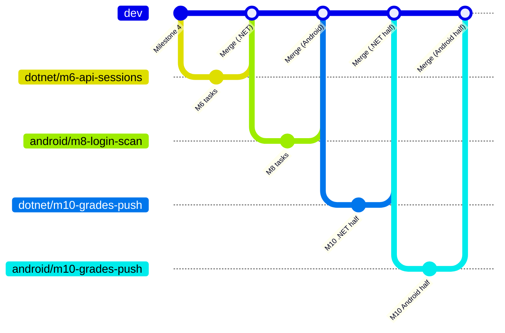

# Klasly Git Workflow Manual

How the Klasly team uses branches: where to start new work, how to name the branch,
and how it gets back into `dev` and `master`. Read this before starting a milestone.

## 1. The branches at a glance



| Branch | Lives | What goes in it |
|--------|-------|-----------------|
| `master` | forever | Finished, reviewed work. Only updated by a PR from `dev`. |
| `dev` | forever | The team's working line. Every milestone branch merges here. |
| `dotnet/m<N>-<slug>` | one milestone | .NET work: `src/` (API, Web, Worker, Core, Infrastructure) and `tests/`. |
| `android/m<N>-<slug>` | one milestone | Android work: `android/KlaslyApp`. |
| `backup/dev-before-split` | until the team deletes it | Copy of `dev` before the 2026-11-11 history re-sort (local only). |

## 2. Naming rules

- **Prefix = platform.** `dotnet/` for .NET, `android/` for the Android app.
- **`m<N>` = milestone number** from `CLAUDE.md` section 6, then a short slug in kebab-case.
  Example: `dotnet/m14-role-access-tests`.
- **One milestone on both platforms → two branches with the same slug.**
  Example: `dotnet/m10-grades-push` and `android/m10-grades-push`.
  The shared slug shows they are two halves of one milestone.
- **Merge message label** (the part in brackets tells you the split at a glance):

  | Milestone touches | Merge message ends with |
  |-------------------|-------------------------|
  | only .NET | `(.NET)` |
  | only Android | `(Android)` |
  | both, .NET branch | `(.NET half)` |
  | both, Android branch | `(Android half)` |

  Example: `Merge dotnet/m13-dashboards: Milestone 13 overview endpoints and Parent portal (.NET half)`

- Commit messages keep the existing style: `feat(api): ...`, `feat(web): ...`,
  `feat(worker): ...`, `feat(android): ...`, `fix(...)`, `docs: ...`.

## 3. Step by step: one milestone

1. **Start from the latest `dev`.**
   ```bash
   git switch dev
   git pull
   git switch -c dotnet/m14-role-access-tests
   ```
2. **Commit each task** on that branch (`feat(api): Milestone 14 Task 1 ...`).
   Build and test after every change (`dotnet build`, `dotnet test`, `./gradlew assembleDebug`).
3. **Push the branch** so your teammate can see it.
   ```bash
   git push -u origin dotnet/m14-role-access-tests
   ```
4. **Open a pull request into `dev`** on GitHub. Your teammate reviews it.
5. **Merge with a merge commit** (GitHub: "Create a merge commit", not squash or rebase),
   using the label from section 2. Locally the same thing is:
   ```bash
   git switch dev
   git merge --no-ff dotnet/m14-role-access-tests -m "Merge dotnet/m14-role-access-tests: Milestone 14 role-access tests (.NET)"
   git push
   ```
6. **If the milestone also needs Android**, start `android/m14-<same slug>` from the
   updated `dev` and repeat steps 1–5. Do the .NET half first: Android calls the API,
   so the endpoints must exist before the app uses them.
7. **Release:** when `dev` is stable, open a PR from `dev` into `master`.

**Small changes** (a typo, a report, a docs fix) can go straight to `dev` without a branch.

## 4. Reading the history

```bash
git log --oneline --first-parent dev        # one line per milestone branch
git log --oneline --graph dev               # full picture with the branch lines
git log --oneline <merge-hash>^1..<merge-hash>^2   # the commits inside one merge
```

## 5. The re-sort of 2026-11-11

Milestones 5–13 were first committed in one straight line on `dev`. They were
re-sorted into the branches below so the history follows this manual. Rules kept:

- Commit order never changed, so every merge point on `dev` has exactly the same
  files as a commit on the old line. The final files are identical
  (`git diff backup/dev-before-split dev` prints nothing).
- Author name and author date are unchanged; only the commit hashes are new.
- `origin/dev` (Milestone 4) is still an ancestor, so no force-push was needed.

| # | Branch | Milestone | Commits |
|---|--------|-----------|---------|
| 1 | `dotnet/m5-web-admin` | 5 Web MVC login and Admin pages (.NET) | 7 |
| 2 | `dotnet/m6-api-sessions` | 6 sessions, QR token and scan endpoint (.NET) | 9 |
| 3 | `dotnet/m7-web-teacher-session` | 7 teacher session page with rotating QR (.NET) | 7 |
| 4 | `android/m8-login-scan` | 8 Android login and Scan QR (Android) | 13 |
| 5 | `dotnet/m9-worker-corrections` | 9 Hangfire Worker, auto-Absent and corrections (.NET) | 4 |
| 6 | `dotnet/m10-grades-push` | 10 assessments, grades and FCM sender (.NET half) | 1 |
| 7 | `android/m10-grades-push` | 10 FCM grade push in the app (Android half) | 1 |
| 8 | `dotnet/m11-worker-risk` | 11 Worker risk flags (.NET) | 6 |
| 9 | `dotnet/m12-alerts-brevo` | 12 parent alerts and Brevo emails (.NET) | 7 |
| 10 | `dotnet/m13-dashboards` | 13 overview endpoints and Parent portal (.NET half) | 6 |
| 11 | `android/m13-dashboards` | 13 student and parent overview screens (Android half) | 4 |

Milestone 10 had been made as one commit touching both platforms (old `8f31453`).
It was split by folder: everything outside `android/` went to the .NET half, and
`android/` went to the Android half. Both commits keep the original message and
say where the other half is.

The 11 branches are kept (locally and on GitHub) as labels for each milestone.

## 6. Recovering something

| Need | Command |
|------|---------|
| The old straight-line `dev` | `git log backup/dev-before-split` (local branch) |
| The abandoned Milestone 3 draft from the old `claude/klasly-milestone-2` worktree | `git stash list`, then `git stash show -p stash@{0}` |
| A deleted old branch | `git branch <name> <hash>`; the hashes are listed in `docs/reports/2026-11-11-1112-git-branch-split/DEVELOPER-DOCS.md` |

## 7. Do and don't

- **Do** start every milestone branch from a freshly pulled `dev`.
- **Do** keep one branch per milestone and platform, not one per task.
- **Don't** force-push `dev` or `master`.
- **Don't** commit `.idea/`, `.claude/`, secrets or connection-string passwords.
- **Don't** merge a branch whose build or tests fail.
