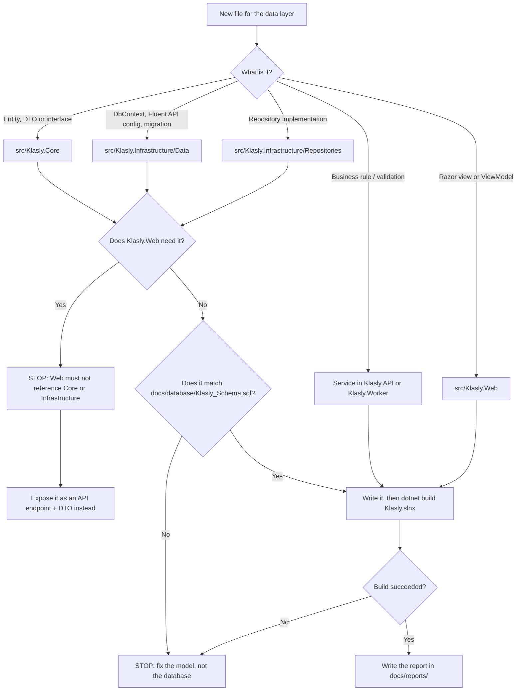
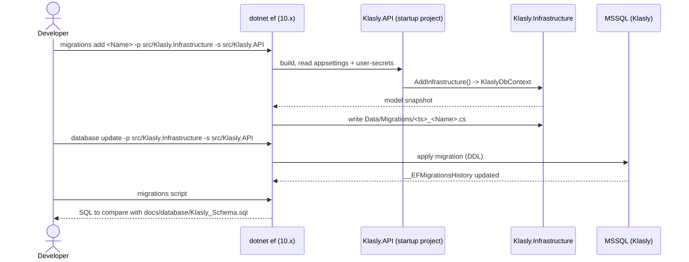

# FLOWCHARTS — Docs/layout sync

## Where does a new data-layer file go?

## How a migration reaches the database

The startup project (`Klasly.API`) supplies the connection string and the DI container; the migrations themselves live in `Klasly.Infrastructure`. Both names changed in this update.

No `erDiagram` this time — the database did not change.
