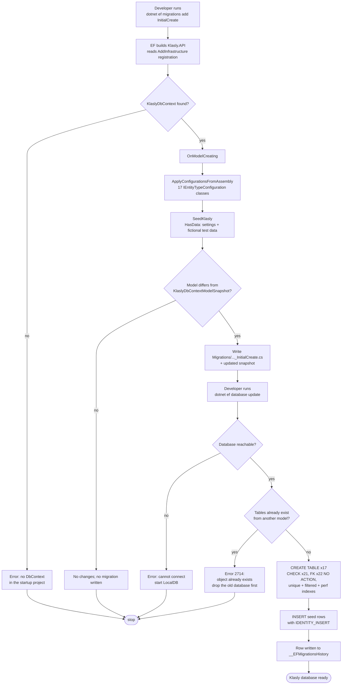
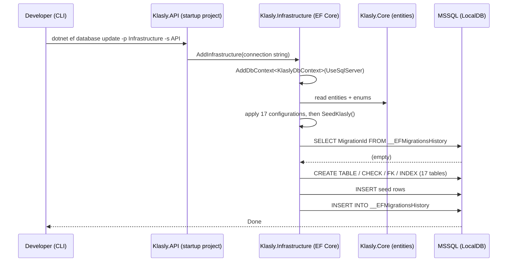
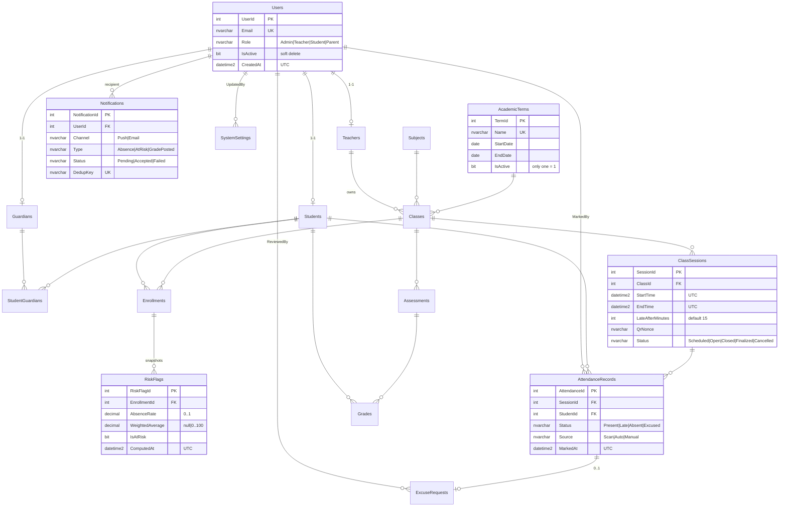

# Flowcharts — Milestone 2: model, configuration and first migration

## 1. What happens when a migration is created and applied

## 2. Layers involved in creating the schema

## 3. The 17 tables created by this migration

