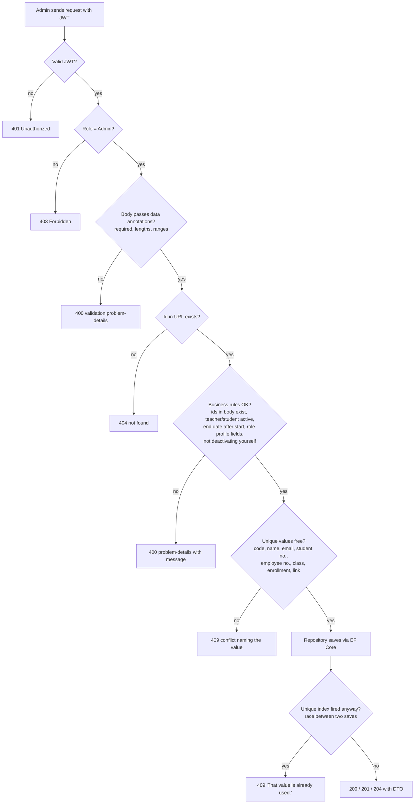
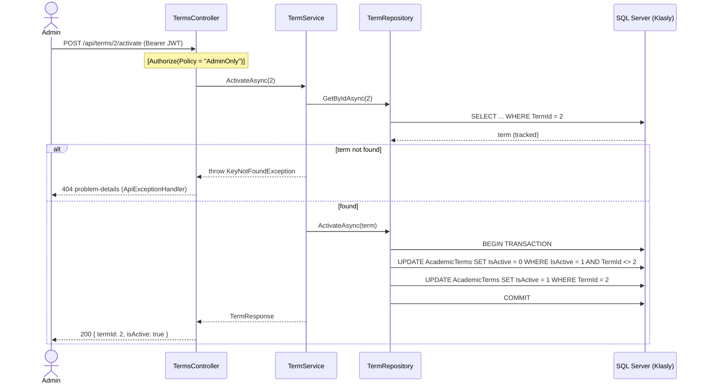
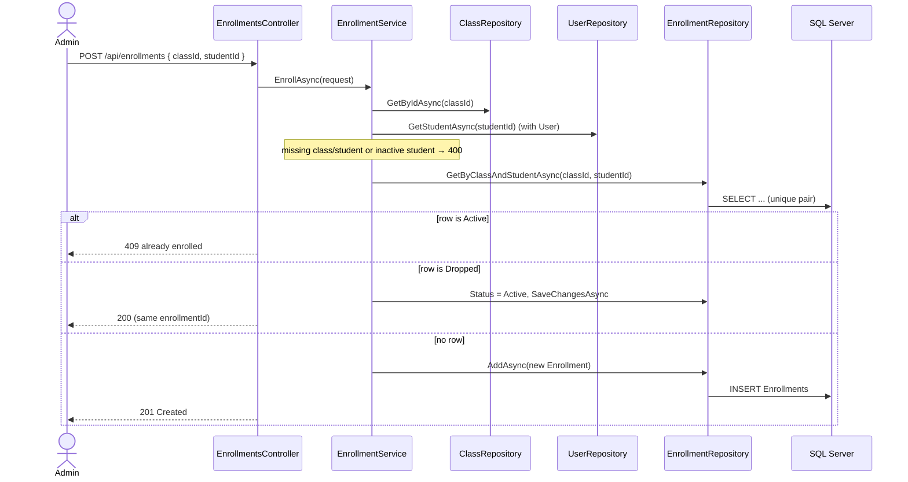
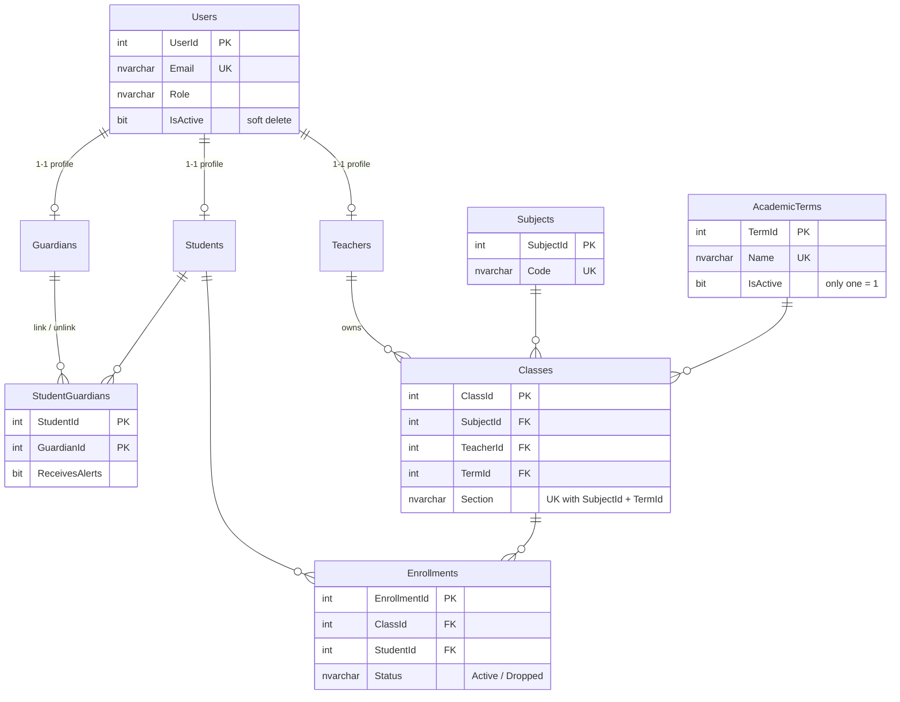

# Milestone 4 — Admin CRUD · Flowcharts

## Request logic (every admin endpoint)

## Activate a term (layers)

## Enroll a student (layers)

## Tables this milestone reads and writes (no schema change)

