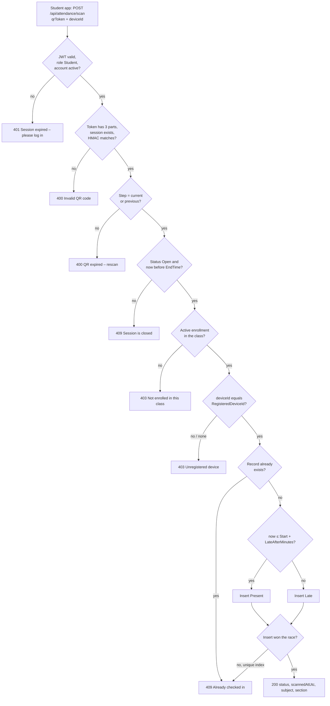
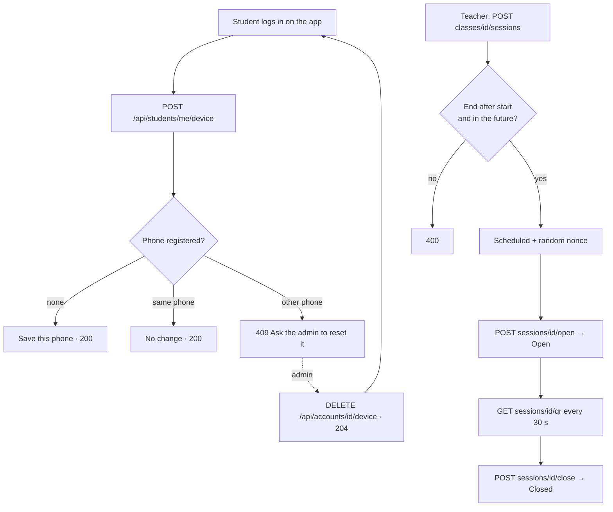
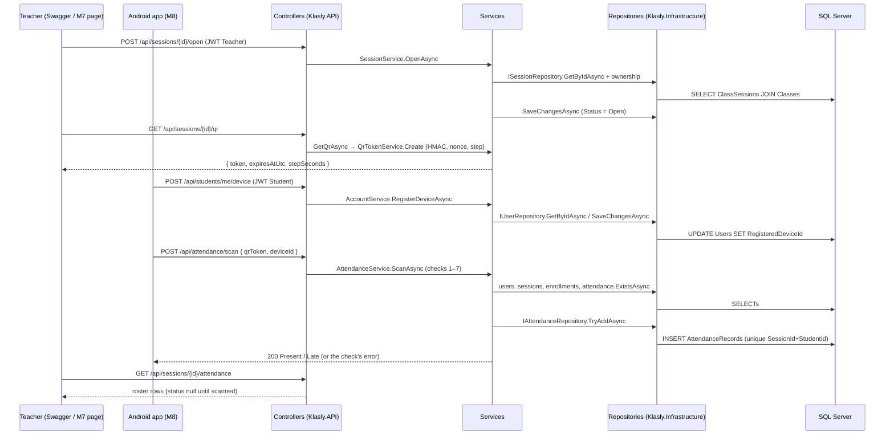

# Flowcharts: Milestone 6 QR check-in

## Scan logic (guide §27.8 order)

## Device registration and teacher session flow

## Sequence across the layers

No `erDiagram`: the database did not change.
