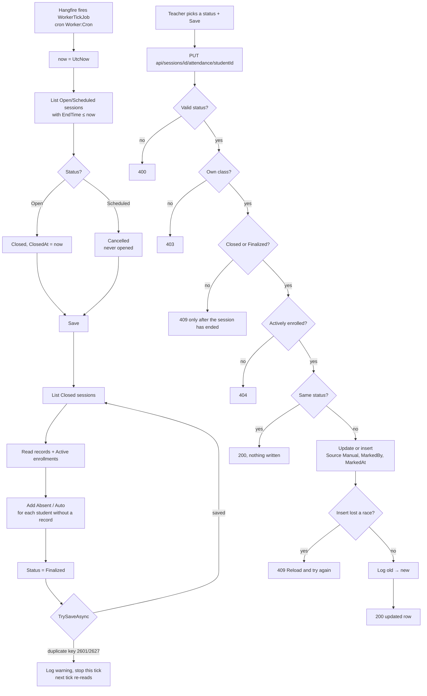

# Flowcharts: Worker finalize + attendance corrections

## Worker tick and correction logic



## Sequence across the layers

```mermaid
sequenceDiagram
    participant H as Hangfire (Worker)
    participant J as WorkerTickJob
    participant F as AttendanceFinalizer
    participant Rp as Repositories (EF Core)
    participant DB as MSSQL Klasly
    participant B as Teacher browser
    participant M as Web MVC
    participant A as Web API

    H->>J: RunAsync(ct) every tick
    J->>F: CloseEndedSessionsAsync(now)
    F->>Rp: ListEndedAsync(now)
    Rp->>DB: SELECT ... WHERE Status IN (Open, Scheduled) AND EndTime <= now
    F->>Rp: SaveChanges (Closed / Cancelled)
    J->>F: MarkAbsentAndFinalizeAsync(now)
    loop each Closed session
        F->>Rp: records + enrollments
        F->>Rp: Add Absent rows, Status = Finalized
        F->>Rp: TrySaveAsync (one transaction)
        Rp->>DB: INSERT AttendanceRecords; UPDATE ClassSessions
    end

    B->>M: POST Teacher/Sessions/Correct (anti-forgery)
    M->>A: PUT api/sessions/{id}/attendance/{studentId} (JWT)
    A->>Rp: own session? enrolled? record
    Rp->>DB: UPDATE / INSERT AttendanceRecords
    A-->>M: 200 SessionAttendanceRow (or 400/403/404/409)
    M-->>B: Redirect + "Attendance updated for …" (or the API's message)
```

No `erDiagram`: the database did not change.
