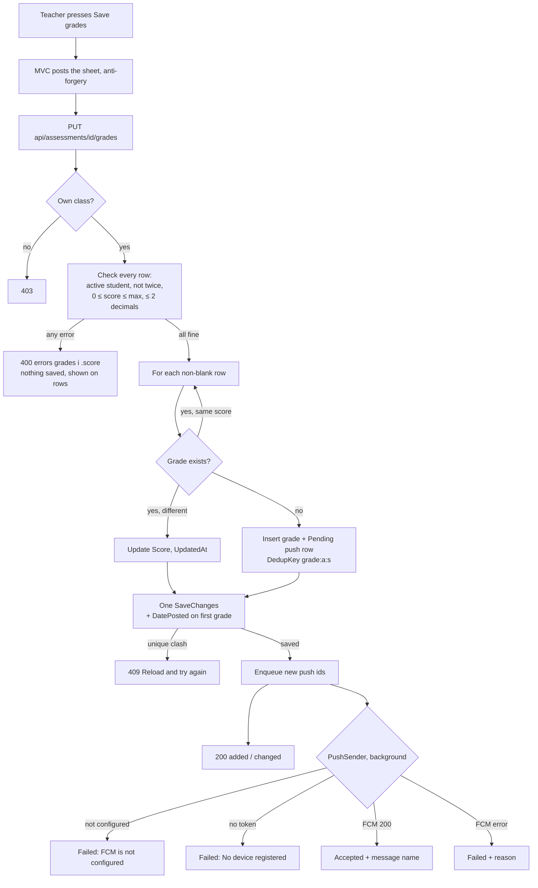
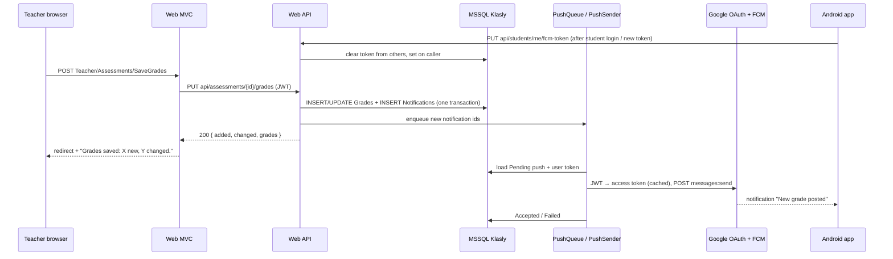

# Flowcharts: assessments, grade entry and the grade push

## Grade save and push logic

## Sequence across the layers

No `erDiagram`: the database did not change (Assessments, Grades, Notifications and Users.FcmToken already existed).
