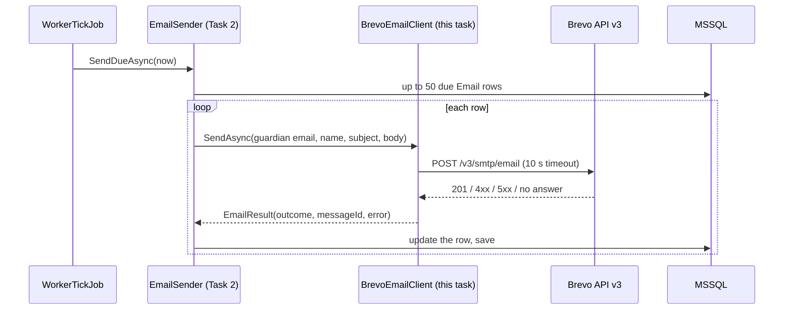

# Flowcharts — Milestone 12 Task 1 (Brevo email client)

## Client logic

```mermaid
flowchart TD
    A[SendAsync to, name, subject, text] --> B[POST smtp/email<br/>api-key header + JSON]
    B --> C{What happened?}
    C -- caller cancelled --> X[throw OperationCanceledException]
    C -- HttpClient timeout --> T1[Transient: timeout]
    C -- network error --> T2[Transient: network error]
    C -- response --> D{Status}
    D -- 2xx --> E[Accepted + messageId<br/>unreadable body → '(no messageId)']
    D -- 401 / 403 --> U[Unauthorized: status + body]
    D -- 429 / 5xx --> T3[Transient: status + body]
    D -- other 4xx --> P[Permanent: status + body]
```

## Where it will sit (after Task 5)



No database change in this task, so no ER diagram.
