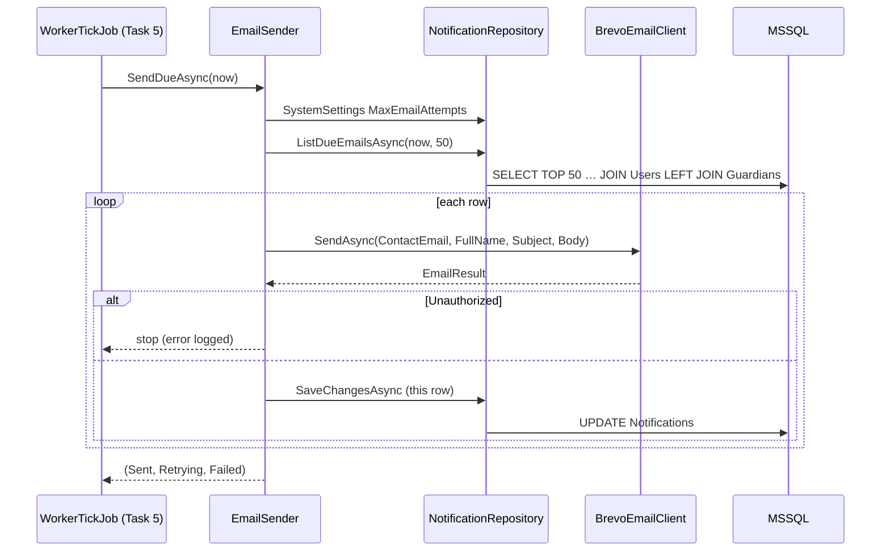

# Flowcharts — Milestone 12 Task 2 (Email sender)

## Sender logic

```mermaid
flowchart TD
    A[SendDueAsync now] --> B{MaxEmailAttempts<br/>whole number 1–20?}
    B -- no --> X[throw: step fails, nothing sent]
    B -- yes --> C[Load up to 50 due Email rows<br/>Pending, NextAttemptAt null or ≤ now, oldest first]
    C --> D{Brevo configured?}
    D -- no --> E[All listed rows Failed<br/>'Brevo is not configured'] --> S1[save, return]
    D -- yes --> F[next row]
    F --> G{User has a guardian?}
    G -- no --> H[Failed 'No guardian email'] --> SAVE
    G -- yes --> I[Brevo SendAsync]
    I --> J{Outcome}
    J -- Unauthorized --> K[log error, stop<br/>row untouched, Attempts 0] --> R[return counts]
    J -- other --> L[Attempts++]
    L --> M{Outcome}
    M -- Accepted --> N[Accepted + messageId]
    M -- Transient, attempts left --> O[Pending, LastError,<br/>NextAttemptAt = now + 5·2^(n−1) min + 0–60 s]
    M -- Permanent / Transient at max --> P[Failed + LastError ≤ 500 chars]
    N --> SAVE[save this row]
    O --> SAVE
    P --> SAVE
    SAVE --> Q{more rows?}
    Q -- yes --> F
    Q -- no --> R
```

## Across the layers



No schema change in this task, so no ER diagram.
