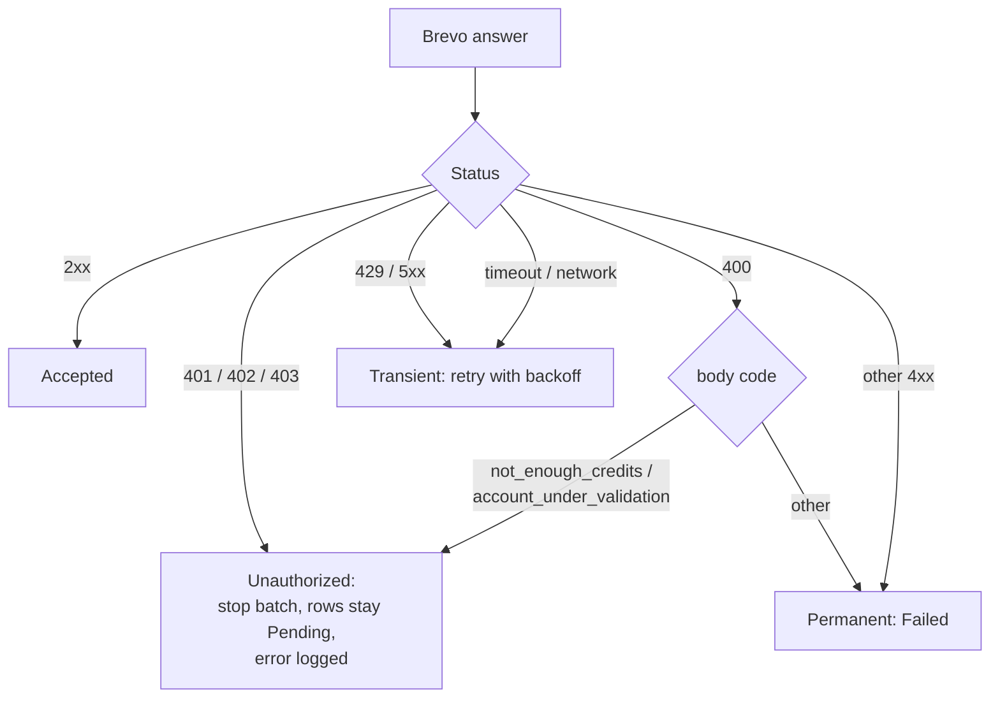
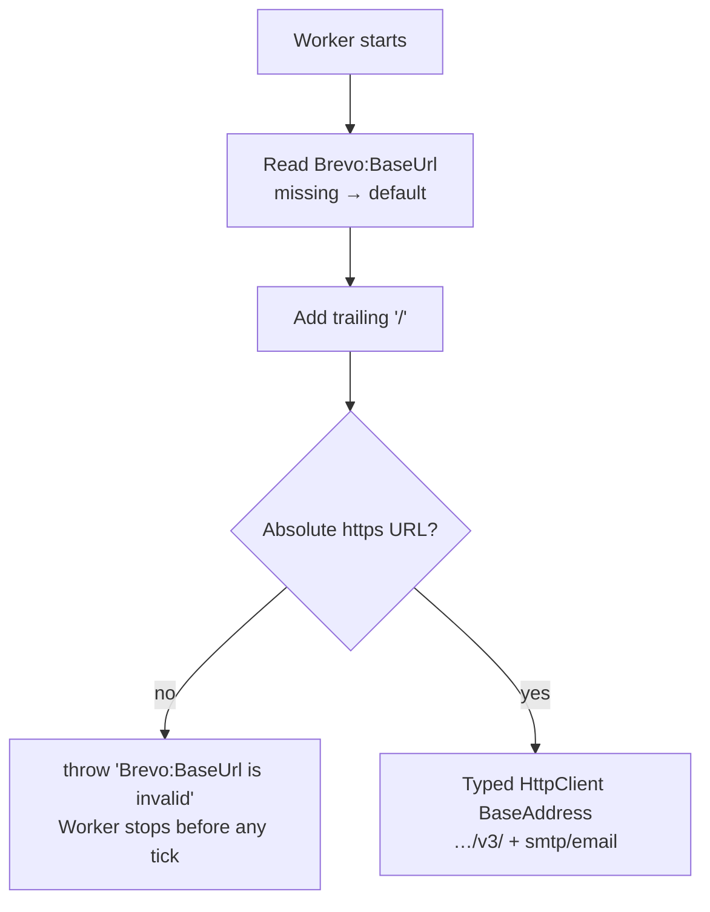

# Flowcharts — Milestone 12 review fixes

## How a Brevo answer is sorted (after the fix)



## Worker startup with the Brevo base URL



## Setup flow (Task 6)

```mermaid
sequenceDiagram
    participant T as Team member
    participant BR as Brevo website
    participant US as user-secrets (local)
    participant DB as Klasly dev DB
    participant W as Worker
    participant API as Brevo API
    T->>BR: sign up, confirm email, profile
    T->>BR: add sender, confirm it
    T->>BR: generate API key (xkeysib-…)
    T->>US: Brevo:ApiKey, Brevo:SenderEmail
    T->>DB: guardians → team inboxes; insert fresh absence
    T->>W: dotnet run (1-min cron)
    W->>DB: queue alert
    W->>API: POST /v3/smtp/email
    API-->>W: 201 messageId
    W->>DB: Accepted + messageId
    API-->>T: email in inbox
```

No schema change, so no ER diagram.
