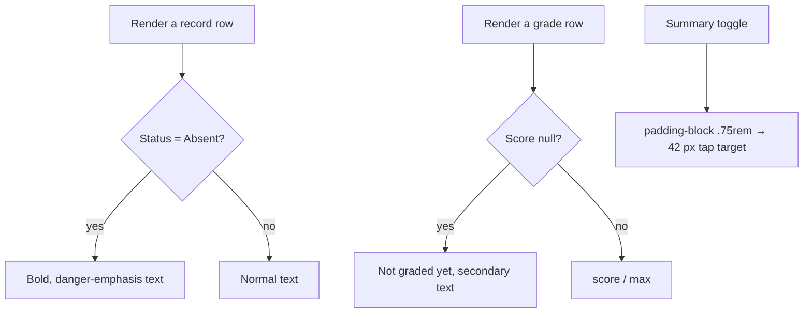
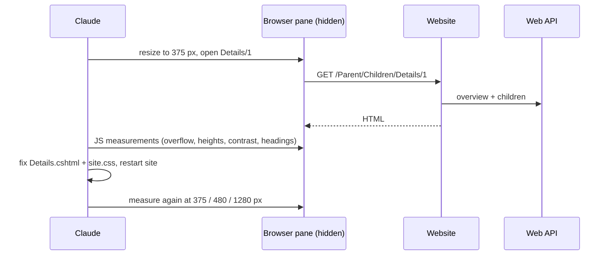

# Flowcharts — Milestone 13 Task 5 (Parent portal polish)

## Logic (how each attendance and grade cell is styled)

## Sequence (how the polish was verified)

No database change, so there is no ER diagram.
