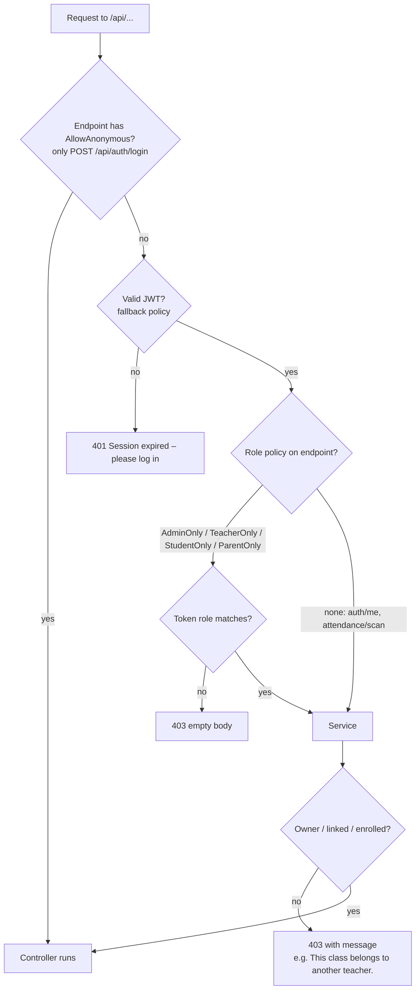
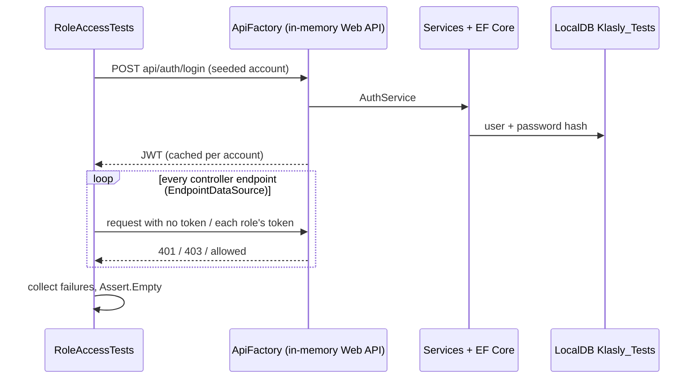
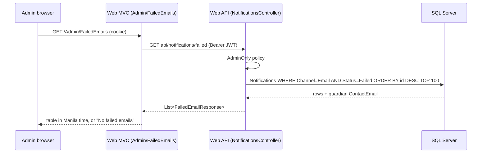

# Flowcharts — Milestone 14

## How a request is checked (what the role and ownership tests prove)

## Sequence: role sweep test → in-memory API → test database

## Sequence: admin opens Failed emails

No database schema change, so no ER diagram.
