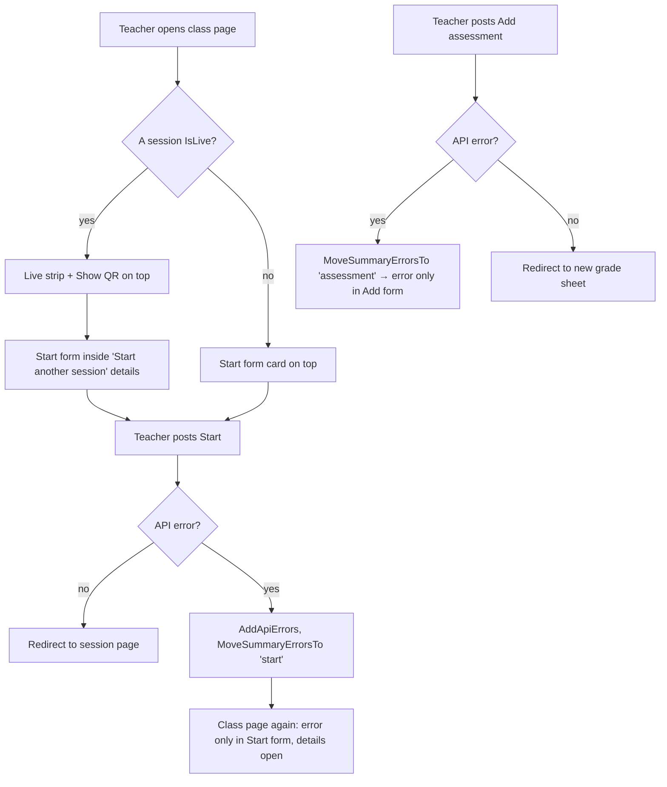

# Flowcharts — ui-teacher



```mermaid
sequenceDiagram
  participant Teacher
  participant MVC as Klasly.Web
  participant API as Klasly.API
  Teacher->>MVC: POST /Teacher/Sessions/Correct/1?studentId=4 (status, currentStatus)
  MVC->>API: PUT attendance correction
  API-->>MVC: 200 row
  MVC-->>Teacher: 302 /Teacher/Sessions/Details/1#row-4 (+ flash)
  Teacher->>MVC: GET /Teacher/Sessions/Details/1
  MVC-->>Teacher: page; browser scrolls to tr#row-4
```
